<p align="center">
  
</p>

<h1 align="center">Casier</h1>

<p align="center"><em>A fast, keyboard-first file manager for Wayland, small enough to forget it is running.</em></p>

<p align="center">
  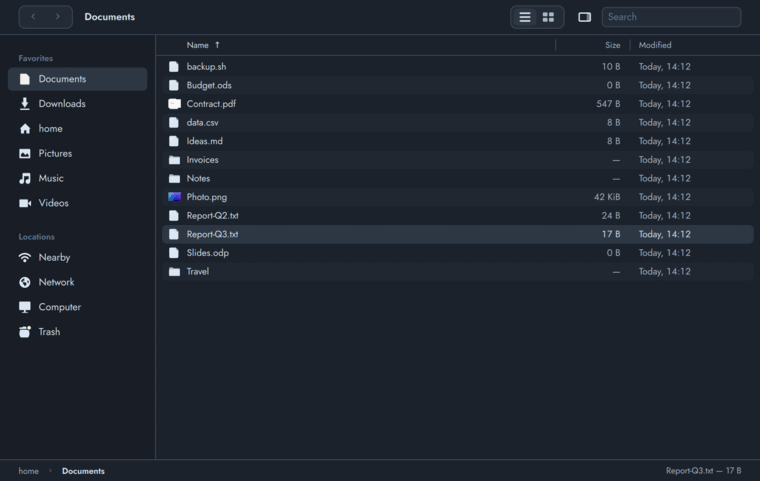
</p>

The program is `fili-file`; **Casier** is the name you see. Both commands do the same thing:

```
casier ~/Documents
fili-file ~/Documents
```

Written in Rust, with a Qt Quick interface compiled into a single binary. It belongs to
[Filigrane](https://github.com/filigrane-os/filigrane), a Void Linux + niri distribution, but it does not need it: it runs on any
Linux distribution with Qt 6 and a Wayland compositor.

## Why it exists

Filigrane is an operating system that tries to be forgotten: the browser, the AI agents and the containers get the memory
and the CPU, the system keeps out of the way. A file manager is the application you open all day, so it has to cost little,
open at once and stay out of the way too. Casier was written to be that, and to do things the usual file managers were not
built for: be driven by an assistant, send files to a nearby device in two clicks, and follow the look of the desktop
without a toolkit's theming layers.

## Philosophy

- **Keyboard first.** Everything has a shortcut and nothing needs the mouse. Typing in the list jumps to the name; `/` or
  `Ctrl+F` opens a fuzzy search over the folder and all its subfolders; `Ctrl+L` takes a path with fzf-style suggestions
  and jumps to folders you already visited, like zoxide. Shortcuts stay quiet while you type a name. The mouse works the way
  you expect too: drag and drop, rubber-band selection, tabs you can pull out into windows.
- **Controlled by an AI assistant, or a script.** Every window answers on a local socket: `fili-file ctl state` says
  where you are and what is selected, `fili-file ctl actions` lists every command with its shortcut and whether it is
  available, `fili-file ctl action copy` runs it, `ctl goto`, `ctl select` and `ctl show` move and select. The assistant sees
  the folder and the selection of the window you are looking at, and acts through the same commands as the menu, never by
  faking key presses.
- **Nearby.** Send files to a phone or another computer next to you the way AirDrop does: devices on the local network
  (LocalSend) and paired Bluetooth devices appear as targets, you drop files on them, and the files you receive land in a
  list. This part uses the optional `fili-share` program.
- **Modern, not heavy.** A GPU-rendered Qt Quick interface with inertial scrolling, tabs, live updates (inotify), quick look
  on Space, a preview panel, thumbnails, bulk rename and a task queue for copies, all in one native binary. No GTK, no
  Electron, no browser engine.
- **Themable down to the pixel.** Colors, fonts, sizes and radii are plain TOML, light and dark follow the desktop, and any
  freedesktop icon theme works. The defaults are one coherent look; you change only the lines you care about.

## Resources

Casier is built to be cheap. Nothing stays resident when the last window is closed (unless you turn on `resident`, below); the file chooser service for
browsers starts on demand and exits after two minutes without a request. Measured on the author's machine
(`scripts/measure.sh`, 6 seconds after opening, release build 1.0.x, Qt 6.11, niri):

| | Proportional memory (PSS) | Private memory | Resident (RSS) |
|---|---|---|---|
| A folder with a few files | 72 MiB | 47 MiB | 156 MiB |
| A folder with 5000 files | 85 MiB | 59 MiB | 169 MiB |

The binary is 5.4 MiB, fonts included. The window shows in about a quarter of a second. The proportional figure counts the
Qt libraries shared with other Qt applications only once; the private figure is what Casier alone costs.

These numbers are a measurement of Casier, not a promise about other programs: a Qt Quick application carries its scene
graph and its GPU driver, so Casier will not be the smallest process you can start. To compare it with the file manager
you use today, run the same script on both, with the same folder, on your own machine:

```
scripts/measure.sh casier ~/Documents
scripts/measure.sh thunar ~/Documents      # or nautilus, dolphin, pcmanfm...
```

**Resident mode (optional, off by default).** With `resident = true`, `fili-file --spare` keeps a copy of Casier loaded
and hidden; opening Casier hands the launch to it, so the window appears in about 0.15 s instead of 0.4 s (measured, same
machine), and a new copy loads for the next time. It costs about 35 MB of private memory while it is on (the Qt and Mesa
libraries it uses are shared with other Qt programs). Control it with `fili-file spare on|off|status`; `fili-file spare
auto` starts it at the beginning of a session when it is on.

## Screenshots

All of them are generated by `scripts/screenshots.sh` on a throw-away home folder, so they can be regenerated for a website.

| | |
|---|---|
| 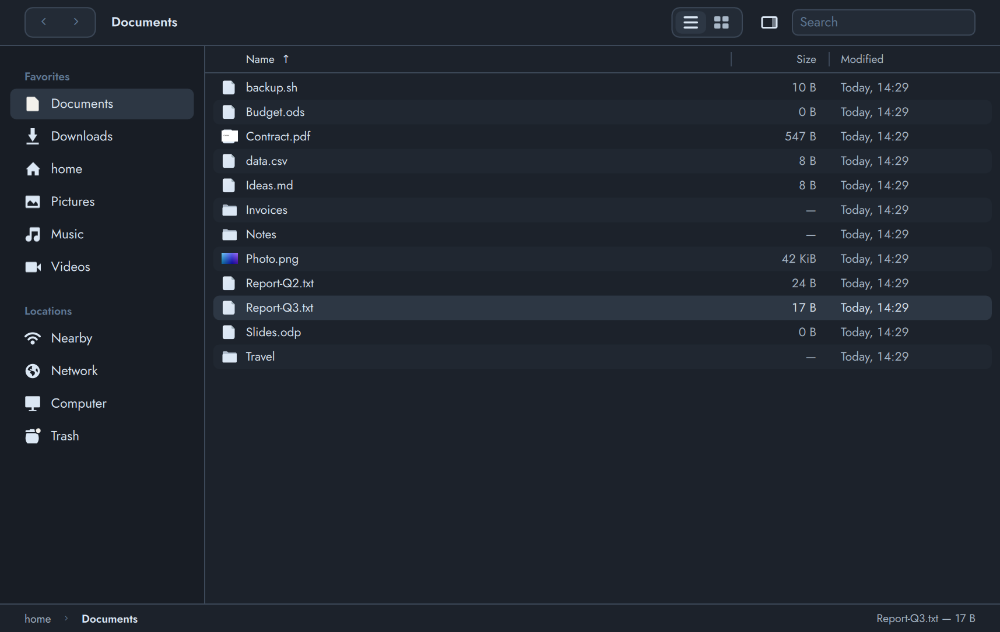 **List view** | 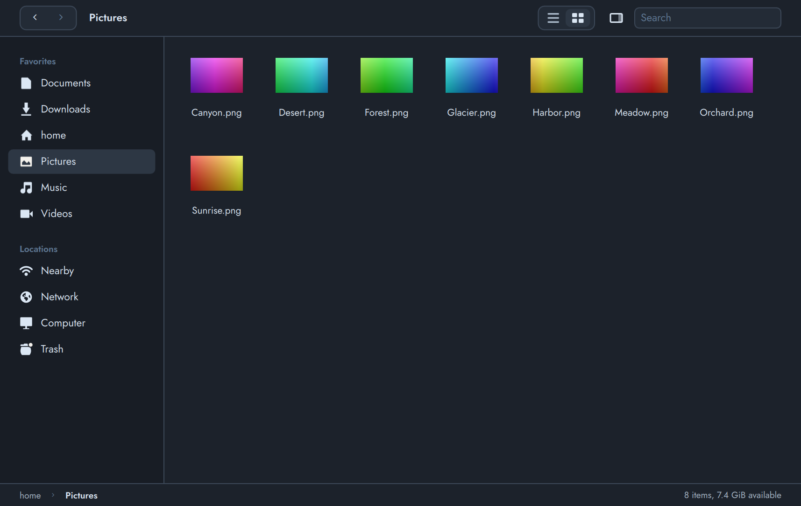 **Grid view** with thumbnails |
| 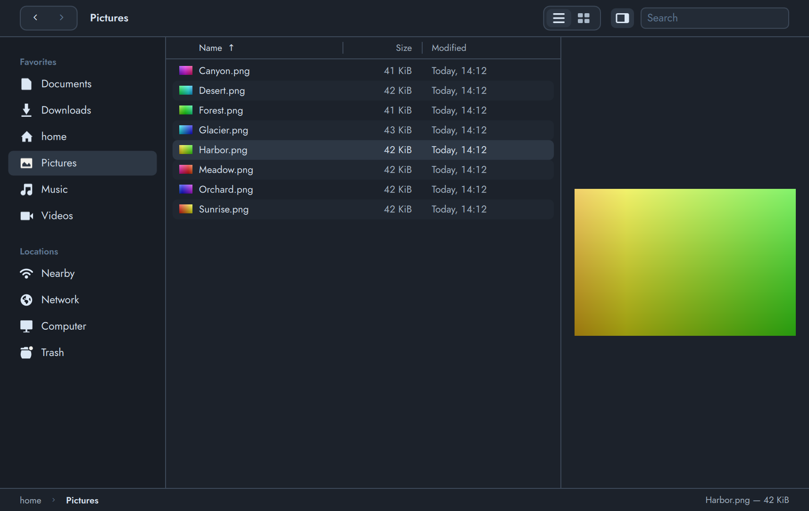 **Preview column** | 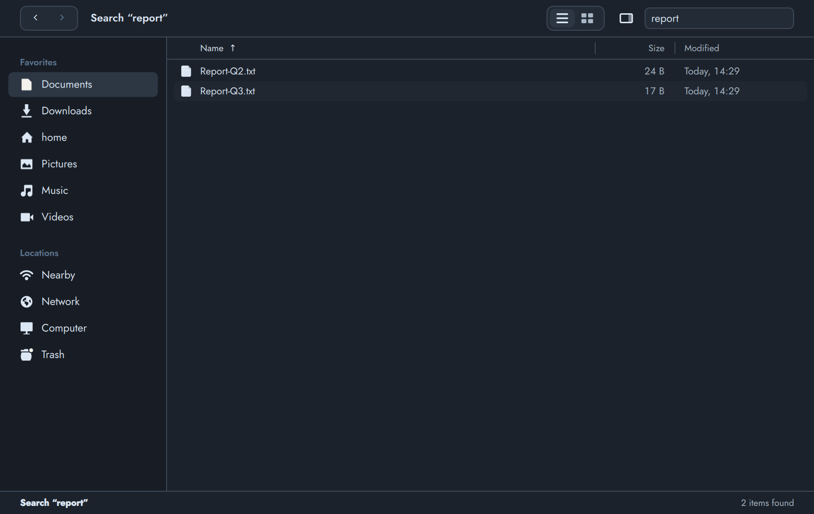 **Search** across the folder and its subfolders |
| 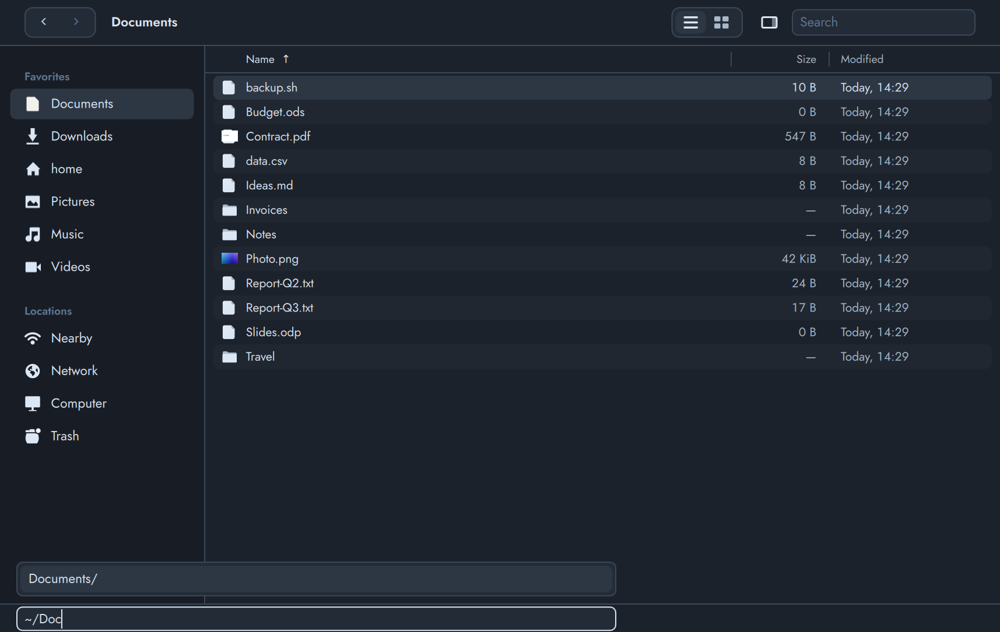 **Interactive path** with suggestions | 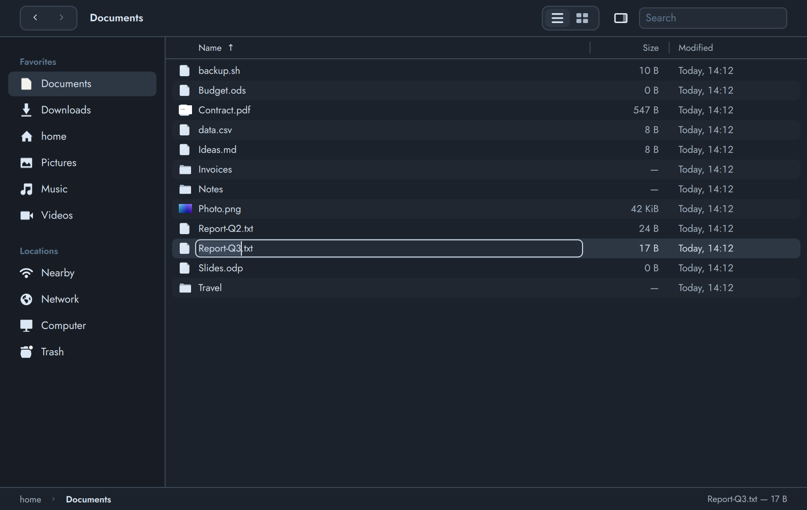 **Rename** in place |
| 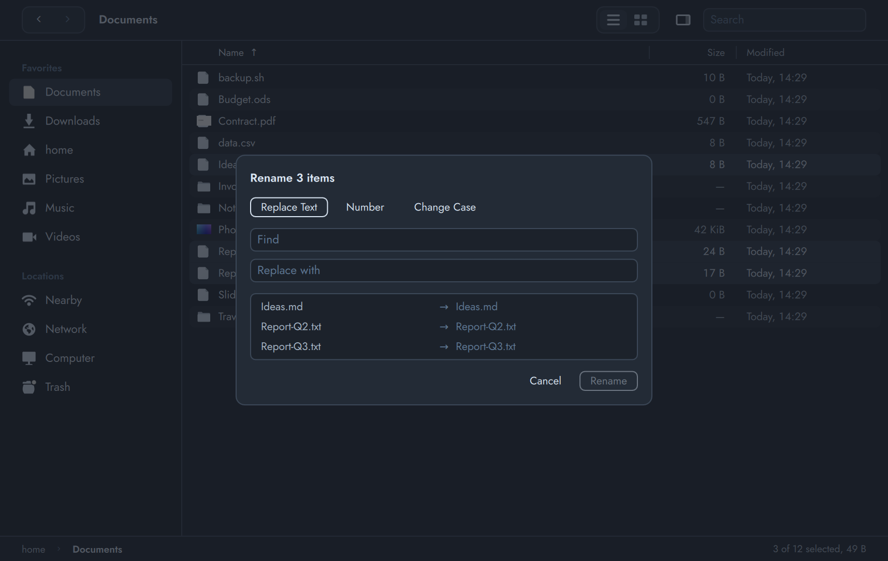 **Bulk rename** with a live preview | 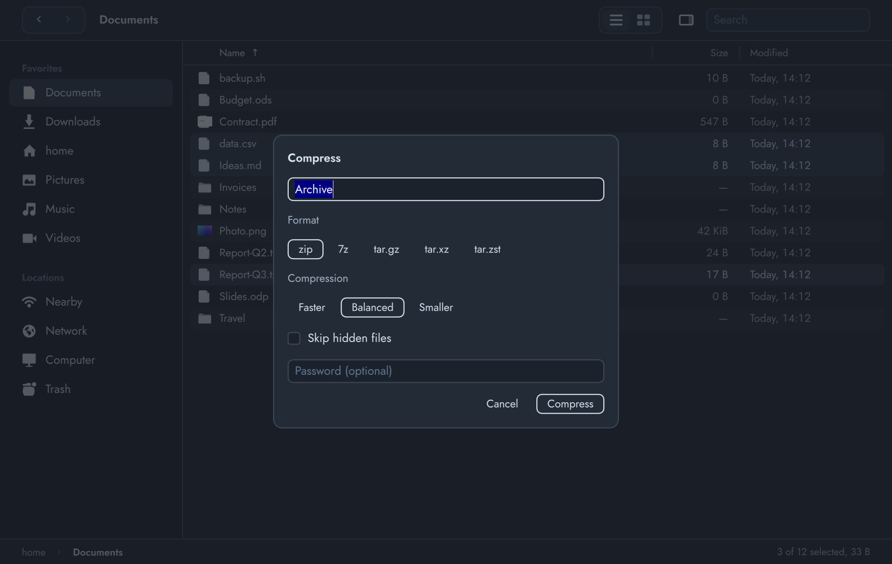 **Compress** (zip, 7z, tar) |
| 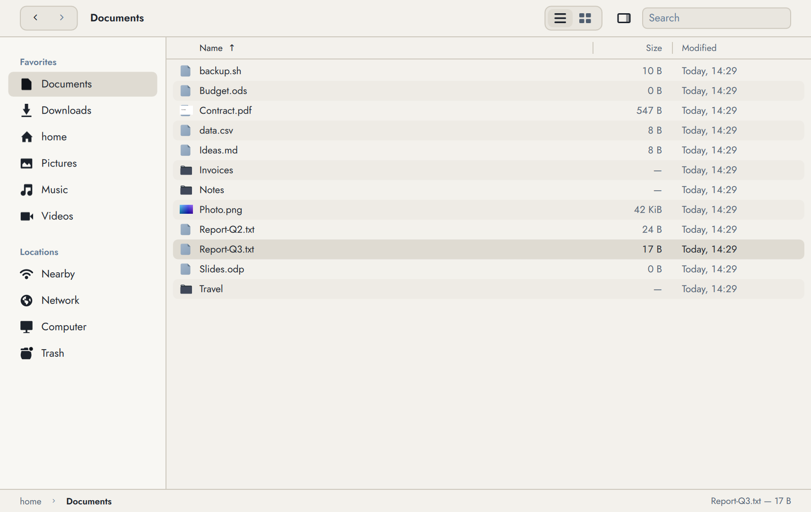 **Light theme** | 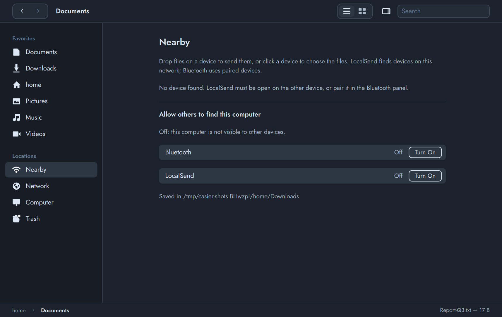 **Nearby** sharing |

Accents, in dark and light:

| | | |
|---|---|---|
| 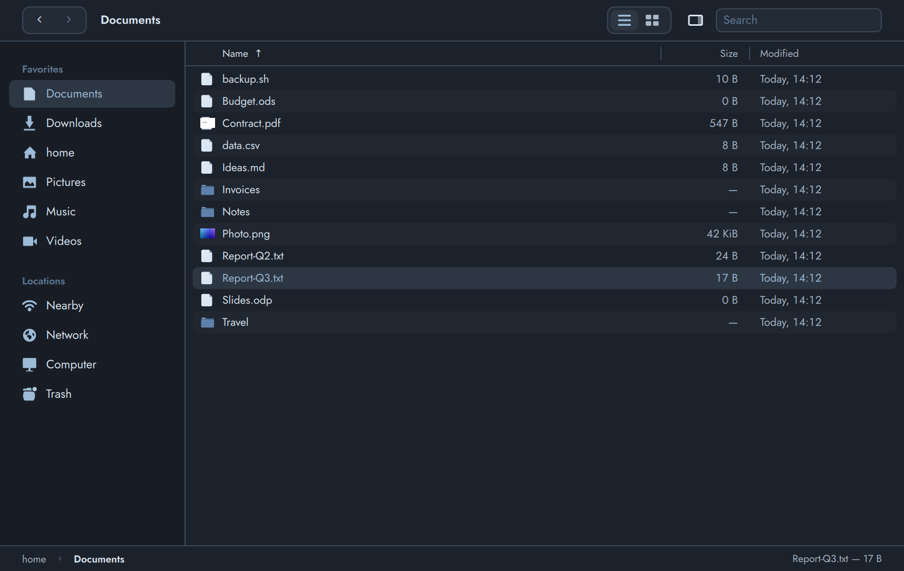 | 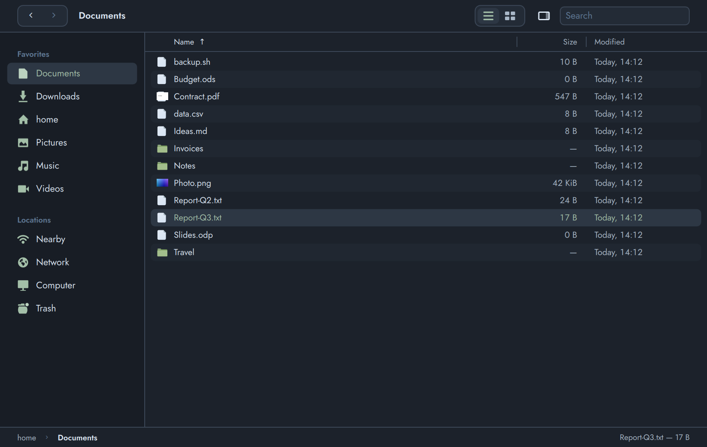 | 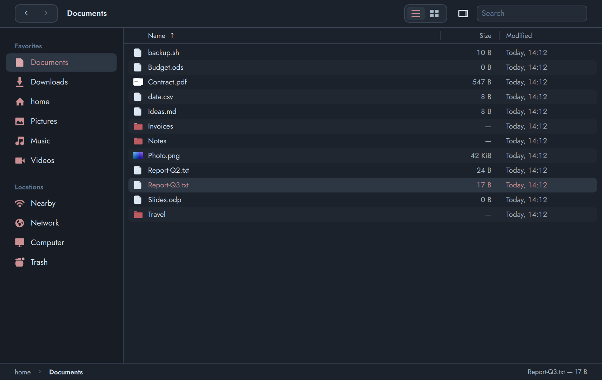 |
| 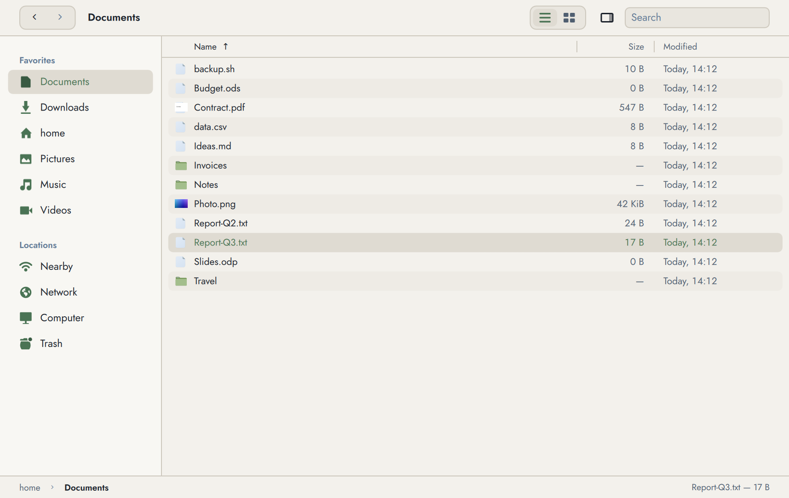 | 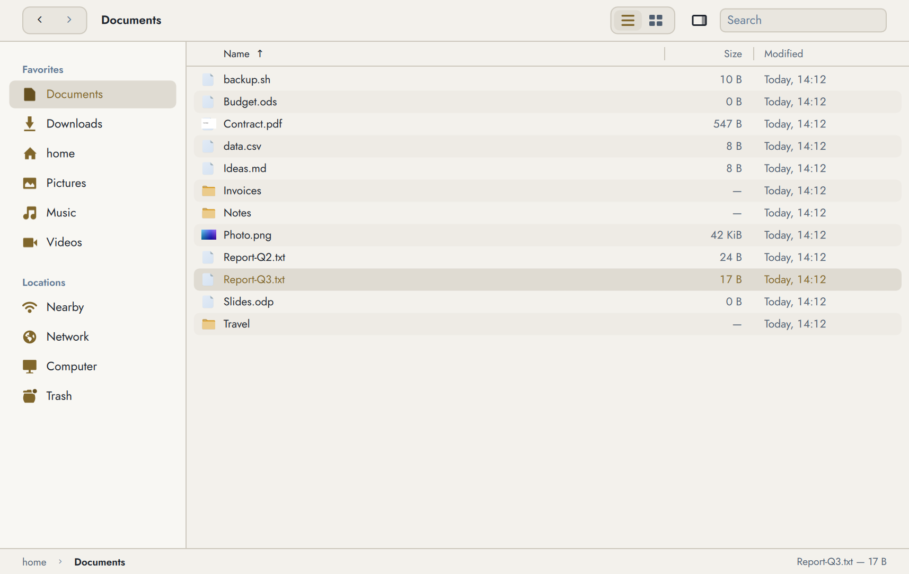 | 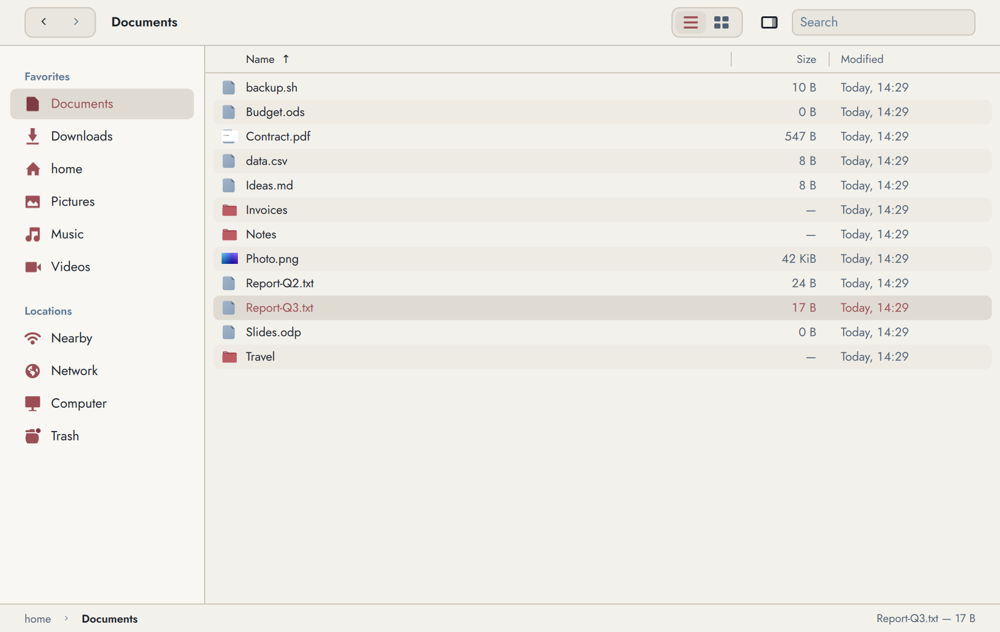 |

## Features

- List and icon views, tabs (drag a tab out to detach it), live updates of the folder shown (inotify)
- Copy, cut, paste, drag and drop, bulk rename, undo, trash (including the trash of other volumes)
- Quick look (Space), preview panel, thumbnails for images and PDF, file info with SHA-256
- Compress and extract (zip, 7z, tar.gz/xz/zst, with passwords), built in: Casier drives `tar`, `zip` and `7z`
  (**Archiveur**, below, is the same engine without a window)
- Volumes, USB drives, MTP phones and network places (SMB, SFTP) through udisks and gvfs; the servers announced on
  the local network (NAS boxes, Macs, Linux machines with Samba or SSH) are listed in the sidebar by themselves, one click
  opens Connect to Server with their address filled in (multicast DNS, no daemon needed). A server is one row in the
  sidebar, its shares are its folders, and the password can be kept in your keyring so that favorites inside a share
  reconnect with a click
- File chooser portal backend (`org.freedesktop.impl.portal.FileChooser`) so browsers use it for "Open" and "Save as"
- Controllable from a terminal or an assistant: `fili-file ctl actions`, `fili-file ctl state`, `fili-file ctl action NAME`
- Any freedesktop icon theme, light and dark mode that follows the desktop, fully themable colors and fonts
- **Open With** and double click launch the application directly; when it is already running, its window is brought to
  the front (niri), since Wayland does not let it take the focus by itself
- **Window buttons** at the far right of the toolbar: Close, and a Window panel with one pictogram tile for every niri
  window action (fullscreen, maximize, fill the width, preset widths and heights, center, floating, move or join columns,
  tabbed column, overview, send to another workspace or monitor, screenshot). It opens with `Ctrl+Shift+W`, is driven
  with the arrow keys (first tile preselected, Enter runs it), highlights what describes the window now (fullscreen,
  floating, full width), adapts its layout to the room the window leaves, and says what an action will really do (a
  window sharing its column leaves it instead of joining the neighbour). Outside niri it offers fullscreen, maximize and
  minimize. Hide the buttons with `window_buttons = false` or from the Window menu of the bar
- Sorted by modification date, most recent first, by default (any column, either direction; changing the sort scrolls
  back to the top); mouse wheel and touchpad scrolling with inertia

## Archiveur: compress and extract without a window

The compress and extract engine of Casier also runs as **Archiveur**, with no window and no Qt start-up (about 10 ms):
`fili-archive` and `archiveur` are other names of the `fili-file` binary, like `casier`, and `fili-file archive ...` does the same.
It is what a double click on an archive from the browser or a notification runs, and what scripts and assistants call.

```
archiveur pack photos/              # photos.zip, next to the folder
fili-archive unpack backup.tar.zst  # a folder next to the archive
fili-archive list backup.tar.zst
fili-archive about                  # version, commands, formats
```

`pack [-f zip|7z|tar.gz|tar.xz|tar.zst] [-l fast|normal|best] [--no-hidden] [--password-stdin] [-q] [-o OUT] FILE...`,
`unpack [--password-stdin] [-o FOLDER] ARCHIVE...`, `open` (same as `unpack`, for the file association), `list`, `about`
(see `man fili-archive`). It never overwrites (`Archive 2.zip`), the result only appears once finished, an archive is
extracted into a folder of its own, a password never goes through the arguments, and the paths created are printed, one per
line. Outside a terminal the result is announced with `notify-send` (English or French). With Filigrane's `fili-tx`, each
call is a transaction that `fili-tx undo` reverses; `-q` skips that and the notification (Casier has its own panel and undo).
Default format: `zip`, or `$FILI_ARCHIVE_FORMAT`. The icon uses the "archive" glyph of [Lucide](https://lucide.dev) (ISC).

## Install

```
make                  # build
sudo make install     # installs under /usr/local; PREFIX=/usr for a system package, DESTDIR for packagers
```

The build needs a Rust toolchain (edition 2024, Rust 1.85 or newer), a C++17 compiler, `pkg-config` and the Qt 6
development files (base, declarative, svg). `make` finds `qmake` by itself; set `QMAKE=/path/to/qmake6` if yours is
elsewhere. A linker such as `mold` or `lld` makes linking much faster.

| | Build | Run |
|---|---|---|
| Void | `qt6-base-devel qt6-declarative-devel qt6-svg-devel` | `qt6-declarative qt6-svg qt6-wayland wl-clipboard glib shared-mime-info adwaita-icon-theme util-linux` |
| Arch | `qt6-base qt6-declarative qt6-svg` | `qt6-wayland wl-clipboard glib2 shared-mime-info adwaita-icon-theme util-linux` |
| Debian / Ubuntu | `qt6-base-dev qt6-declarative-dev libqt6svg6-dev` | `qt6-wayland wl-clipboard libglib2.0-bin shared-mime-info adwaita-icon-theme` |
| Fedora | `qt6-qtbase-devel qt6-qtdeclarative-devel qt6-qtsvg-devel` | `qt6-qtwayland wl-clipboard glib2 shared-mime-info adwaita-icon-theme` |

Only the Void names were checked against a package repository; the others are the usual ones and may differ slightly.

Optional programs: `poppler` / `poppler-utils` (`pdftoppm`, PDF thumbnails), `udisks2` (mount and eject), `gvfs`
(network places, phones), `tar`, `zip` and `7z` (compress and extract), `fili-share` (Nearby and Share), `quicklook` (the Space preview window). A feature whose
program is missing is switched off; nothing else depends on them.

The fonts (Jost, JetBrains Mono, Fili Icons) are inside the binary: no font to install.

## Configuration

`~/.config/filigrane/fili-file.toml`, optional. [`fili-file.toml`](fili-file.toml) in this repository lists every
editable setting (general settings and the whole theme) with its default value, all commented out. To use it:

```
mkdir -p ~/.config/filigrane
cp fili-file.toml ~/.config/filigrane/fili-file.toml    # after `make install`: /usr/local/share/doc/fili-file/fili-file.toml
```

Then uncomment only the lines you want to change; a key you leave out keeps its default. Flat settings:

```toml
view = "list"             # "list" or "grid"
show_hidden = false
sort = "date"             # name, size, date (modified), kind, created, permissions, owner
sort_desc = true          # most recently modified first
window_buttons = true     # Close and Window buttons at the right of the toolbar
resident = false          # keep a hidden copy loaded so that Casier opens at once (see Resources)
columns = "size,modified"
start = "~/Documents"     # folder opened when started without an argument
icon_theme = "Papirus"    # default: the desktop's icon theme
folder_icon = "folder"    # icon name for every folder (default: the theme's, else "folder")
file_icon = ""            # icon name for every regular file (default: by type)
```

Colors, fonts, sizes and radii live in the `[theme]`, `[theme.dark]`, `[theme.light]` and `[theme.accents]` sections.
`~/.config/filigrane/theme.toml` (same sections) applies to every Filigrane application, and the defaults are in
[`theme.toml`](theme.toml). The first one found wins, in this order: `fili-file.toml`, `theme.toml`, built-in defaults.

**Icon themes.** Casier follows the freedesktop icon theme specification (`index.theme`, `Inherits`, hicolor last) and
uses the theme set in `icon_theme`, else the desktop's (gsettings, then GTK `settings.ini`), else Adwaita. A theme can
add three optional hints to its `index.theme`, ignored by other applications: `X-Fili-FolderIcon`, `X-Fili-FileIcon`
and `X-Fili-GlyphDir`.

**Light and dark.** Followed from the desktop (settings portal, `org.freedesktop.appearance`), live. Filigrane's own
state file takes precedence when it exists.

**Languages.** English, plus a French catalog built into the binary. To add one without recompiling, put
`<language>.json` (same format as [`i18n/fr.json`](i18n/fr.json)) in `$XDG_DATA_DIRS/fili-file/i18n/`.

## File chooser portal

`make install` also installs the backend description for `xdg-desktop-portal`. It is only used on the desktops listed in
`filigrane.portal` (`UseIn=`, niri by default); to use it elsewhere, add it to your `portals.conf`:

```
[preferred]
org.freedesktop.impl.portal.FileChooser=filigrane
```

## Development

```
make test                      # unit tests
make check                     # unit tests, translation catalog, headless scenarios
```

`tests/run.sh` drives a headless instance (`QT_QPA_PLATFORM=offscreen`) through `fili-file ctl`, in a throwaway
`HOME`, and checks the result on the file system.

## License

GPL-3.0-or-later, see [`LICENSE`](LICENSE). The embedded fonts keep their own licenses (SIL OFL for Jost and JetBrains
Mono, ISC for the Lucide icons behind Fili Icons) in [`licenses/`](licenses/). The application icon is derived from
Nordic-Slot-Dark-Icons (GPL-3.0).
